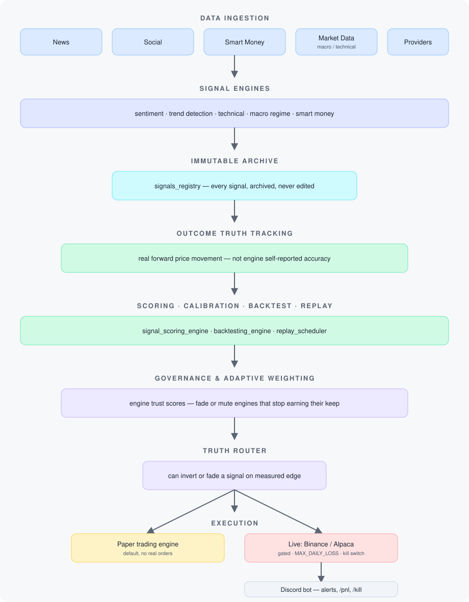

# Fade

An AI-driven market intelligence pipeline that ingests news, social, and smart-money data, turns it into scored trading signals, validates those signals against real price outcomes, and — once a signal has proven itself — routes it into a paper or live trading engine (crypto via Binance, equities via Alpaca) with a hard safety layer in front of any real money.

The system doesn't trust its own signals by default. Every signal is archived immutably, tracked against actual forward price movement, scored for calibration, and fed into a governance layer that can down-weight or **fade** an engine that stops earning its keep — the name comes from that mechanic, and from the trading sense of the word: betting against the crowd, not with it. Nothing gets promoted to live trading on vibes — only on measured, out-of-sample edge.

## How it works



All of it is observable through a FastAPI dashboard and a Prometheus-backed status page.

### Major subsystems (`src/engines/`)

| Layer | Engines |
|---|---|
| Ingestion & scoring | `news_intelligence`, `sentiment_engine`, `smart_money`, `trend_detection`, `technical_engine`, `macro_regime_engine` |
| Truth & validation | `outcome_tracking_engine`, `signal_scoring_engine`, `backtesting_engine`, `replay_scheduler` |
| Governance & adaptation | `engine_governance_engine`, `adaptive_weighting_engine`, `noise_filter` |
| Strategic memory | `strategic_memory_engine`, `regime_transition_intelligence`, `narrative_lifecycle_engine`, `strategic_failure_analysis_engine` |
| Feedback loop | `signal_evaluation_engine`, `feedback_aggregator` |

### Trading execution (`paper_trading_engine/`)

A dedicated engine consumes validated signals through a `truth_router` (which can invert or fade a signal based on its measured historical edge, not just its stated direction), sizes positions with configurable risk rules, and executes against Binance Futures or Alpaca. Real-money trading is gated behind:

- `TRADING_MODE=paper|live` — defaults to paper
- `MAX_DAILY_LOSS` — hard drawdown kill switch
- A Redis-backed manual kill switch (`trading:kill_switch`)
- Stop-loss / trail-stop on every position
- An out-of-sample validation gate before any engine's signals are allowed to touch live capital

A second, unrestricted `paper-trading-engine-sim` instance runs in parallel purely for data collection, with no gating — it exists to generate a clean comparison baseline against the gated live path.

## Stack

- **Runtime**: Python (FastAPI, asyncio), PostgreSQL, Redis, Docker Compose (27 services)
- **Trading**: Binance Futures + Alpaca via direct REST/WebSocket clients (`httpx`/`aiohttp`), no broker SDK dependency
- **Bot / alerting**: Discord (`discord.py`)
- **Observability**: Prometheus + a homepage-style status dashboard (nginx on port 3001)
- **AI**: OpenAI (primary) with Anthropic Claude as fallback, cost-capped via a daily budget guard
- **Local LLM**: in-network Ollama for scheduled lessons/governance analysis

## Setup

### Prerequisites

- Docker + Docker Compose v2 (`docker compose version` should work — the old standalone `docker-compose` binary also works as a fallback)
- `make`, `bash`, `curl`, `git`
- ~8GB RAM for the full stack. Skipping `ollama` (see [Troubleshooting](#troubleshooting)) brings the other 26 services comfortably inside an 8GB VM; `ollama` is the memory-hungry one and is only needed for the weekly LLM job.

Everything else (Postgres, Redis, Prometheus, etc.) runs in containers. You don't need Python installed locally unless you want to run `pytest` outside Docker.

**On Windows**: every command in this README is a `make` target, and Windows has neither `make` nor `bash`. Run the whole thing from WSL2 instead — it is the tested path:

```powershell
wsl --install -d Ubuntu-22.04      # skip if you already have a distro
```

Then, inside the WSL shell, install Docker Engine and the Compose plugin (Ubuntu's own repos don't carry Compose v2):

```bash
curl -fsSL https://get.docker.com | sudo sh
sudo usermod -aG docker $USER
sudo systemctl enable --now docker
```

Run `wsl --shutdown` from PowerShell afterwards so the group membership applies, then clone and work inside WSL. Docker Desktop for Windows works too, but you still need a WSL or Git Bash shell for the `make` targets.

Cloning onto the Windows filesystem (`/mnt/c/...`) works but is slow — WSL reaches it over a 9p mount. Cloning inside the WSL filesystem (`~/fade`) is noticeably faster.

### 1. Clone and configure

```bash
git clone <this-repo-url>
cd fade
cp .env.example .env
```

Open `.env` and set the **three variables that are actually required** to start the stack:

| Variable | What it's for |
|---|---|
| `POSTGRES_PASSWORD` | Database password — pick anything, just not the placeholder |
| `GRAFANA_PASSWORD` | Legacy name from an earlier Grafana setup; no Grafana ships today, but preflight still requires it — set it to anything non-placeholder |
| `DASHBOARD_TOKEN` | Bearer token for the `/api/v1/dashboard/*` endpoints — generate one with `openssl rand -hex 32` |

Everything else in `.env.example` is optional and degrades gracefully:

- No `OPENAI_API_KEY` / `ANTHROPIC_API_KEY` → AI digest generation is skipped, everything else still runs
- No `DISCORD_BOT_TOKEN` → the Discord bot container will fail to start; comment it out of `docker-compose.yml` or just ignore its restart loop if you don't want the bot
- No `BINANCE_API_KEY` / `ALPACA_API_KEY` → trading engines run with nothing to execute against (fine for watching signals only)
- No news/social/market-data provider keys → those specific sources are silently skipped; the pipeline runs on whatever sources *are* configured

### 2. Validate and start

```bash
make preflight   # checks Docker is running, .env is filled in, ports are free
make up          # runs preflight, then docker compose up -d
make health      # hits every service's health endpoint
```

`make preflight` fails loudly and tells you exactly what's missing — run it on its own first if you want to iterate on `.env` without spinning containers up each time.

### 3. Confirm it's alive

```bash
make logs SERVICE=api          # tail one service
curl http://localhost:8000/health
curl -H "X-Dashboard-Token: <your DASHBOARD_TOKEN>" http://localhost:8000/api/v1/dashboard/summary
```

`make up` prints the URLs it started once containers are healthy:

- API: `http://localhost:8000`
- Validation API: `http://localhost:8010`
- Prometheus: `http://localhost:9091`
- Status dashboard (`homepage`): `http://localhost:3001`

All of these bind to `127.0.0.1` only by default — nothing is exposed outside your machine unless you explicitly set `BIND_HOST` in `.env` (e.g. to a Tailscale/VPN IP for remote/phone access) and uncomment the matching line in `docker-compose.yml`.

Trading defaults to **paper mode** — no real orders are possible until you deliberately edit `.env`. See [Going live](#going-live) before you touch that switch.

### 4. What "working" looks like

Give it half an hour, then:

```bash
make verify      # end-to-end pipeline report, straight from Postgres
make check-sql   # static check of embedded SQL against the migrations
```

On a first run with **no API keys at all**, roughly the first 30 minutes should produce something like:

| Table | Typical after ~30 min | Meaning |
|---|---|---|
| `news` | several hundred rows | free RSS sources are being ingested |
| `signals_registry` | tens of rows | engines are scoring and emitting signals |
| `signal_trace` | tracks `signals_registry` | routing decisions are being recorded |
| `tickers`, `market_trends` | ~60+ each | market data is flowing |
| `signal_outcomes` | **0** | correct — outcomes measure *forward* price movement and need hours to elapse |
| `paper_trades` | **0** | correct — see below |

**Zero trades is the expected result, not a failure.** The out-of-sample guardrail deliberately blocks almost everything: only ICE short-confirm and ETF long-confirm signals are allowed through, and neither can clear the gate until there is scored history behind them. A brand-new database has none. Low trade frequency is the design, not a bug.

Two things that look broken and aren't:

- **`discord-bot` restart-looping** — expected without a valid `DISCORD_BOT_TOKEN`.
- **`news_analyze_error` with a DNS failure** in the worker log — the news summariser is reaching for the `ollama` service. Harmless if you skipped it.

## Usage

### Dashboard

The FastAPI dashboard at `http://localhost:8000/dashboard` is served without a token (it's static markup); every data call it makes is authenticated with `DASHBOARD_TOKEN` behind the scenes. Key read endpoints under `/api/v1/dashboard/`: `summary`, `positions`, `trades`, `signals`, `router`, `engine-trust`, `finance`, `journal`, `backtest/summary`. Send `DASHBOARD_TOKEN` as either header `X-Dashboard-Token` or query param `?token=`.

### Discord bot

1. Create an app + bot at the [Discord Developer Portal](https://discord.com/developers/applications), copy the bot token into `DISCORD_BOT_TOKEN`
2. Enable the bot's slash-command scope, invite it to your server, set `DISCORD_GUILD_ID` and your own `DISCORD_ADMIN_USER_ID` in `.env`
3. `docker compose up -d discord-bot` (or it's already running as part of `make up`)

Slash commands: `/help`, `/pnl`, `/positions`, `/stats`, `/market`, `/watch`, `/news`, `/hot`, `/flows`, `/macro`, `/regime`, `/router`, `/pipeline`, `/engine_health`, `/cost`, `/cluster`, `/kill` (kill switch), plus region-scoped `/us`, `/bist`, `/cide`.

### Paper trading (default, safe)

With `TRADING_MODE=paper` (the default), the `paper-trading-engine` service consumes validated signals and simulates fills with no real orders placed. Watch it work via `/pnl` and `/positions` in Discord, or `GET /api/v1/dashboard/trades`. A second `paper-trading-engine-sim` container runs unrestricted (no gating) purely to build a comparison baseline — don't mistake its numbers for the gated engine's.

### Going live

Real orders only fire when **all** of these are true: `TRADING_MODE=live` in `.env`, valid `BINANCE_API_KEY`/`BINANCE_API_SECRET` (or Alpaca equivalents), and the signal has passed the out-of-sample validation gate. Before flipping this:

1. Read `.claude/runbooks/deploy_production.md`
2. Set `MAX_DAILY_LOSS` to an amount you're fully prepared to lose
3. Know the kill switch: `redis-cli SET trading:kill_switch 1` halts trading immediately, or use `/kill` in Discord
4. Start with `BINANCE_TESTNET=true` and confirm the full loop (signal → order → fill → exit) before pointing at a funded account

### Running tests

The suite imports the real engine modules, so install both requirement files
(Python 3.11+; the images use 3.12):

```bash
pip install -r requirements.txt -r requirements-dev.txt
make test
```

No Docker, Postgres, Redis, or network needed — 124 tests, all offline.

Coverage today is concentrated in `paper_trading_engine/` (portfolio, risk, execution, exit logic, reconciliation). The signal/engine pipeline under `src/engines/` doesn't have automated tests yet — see [Known gaps](#known-gaps).

### Troubleshooting

- **`make preflight` fails on a port**: something else on your machine is already using one of the published ports — 3001 (status dashboard), 4000 (miniflux), 5432 (postgres), 6333/6334 (qdrant), 6379 (redis), 8000 (api), 8010 (validation api), 8888 (jupyter), 9091 (prometheus). Stop it or change the host-side port in `docker-compose.yml`.
- **`docker compose up` hangs on `ollama`**: it's the heaviest service and only needed for the weekly LLM lessons/governance job. Comment it out of `docker-compose.yml` if you're on a small machine — nothing else depends on it at startup.
- **Discord bot restart-loops**: almost always a missing/invalid `DISCORD_BOT_TOKEN`. Check `make logs SERVICE=discord-bot`.
- **Dashboard returns 401**: `DASHBOARD_TOKEN` isn't set (fails closed by design), or you're not sending it as `X-Dashboard-Token` / `?token=`.
- **Want remote access (phone, another machine)**: set `BIND_HOST` in `.env` to a reachable interface IP (Tailscale IP recommended over a public IP) and uncomment the matching `${BIND_HOST}` port line(s) in `docker-compose.yml`. Never bind `0.0.0.0` — Docker-published ports bypass your host firewall.

## Repository layout

```
src/                    FastAPI app, engines, providers, scheduler, Discord bot
paper_trading_engine/   Order routing, risk sizing, execution, live/paper trading
signal_edge_analyzer/   Standalone signal-edge analysis tooling
migrations/             SQL schema migrations
sql/                    Ad-hoc / reporting SQL
scripts/                Operational scripts (preflight, health checks) + research scripts
monitoring/             Prometheus config, status homepage
docs/                   Architecture and subsystem reference docs
tests/                  pytest suite (currently paper_trading_engine only)
.claude/                Claude Code tooling: hooks, subagents, and runbooks used to
                         build and operate this project (see below)
```

## Built with Claude Code

This project was developed with Claude Code as a standing collaborator, and the `.claude/` directory is included because the tooling is part of the story:

- `.claude/architecture.md` — architecture reference kept in sync with the actual system
- `.claude/runbooks/` — step-by-step procedures for common changes (add a data source, debug the pipeline, deploy, analyze governance)
- `.claude/hooks/` — enforcement, not documentation: a pre-tool-use hook blocks any edit that would silently flip live trading on or touch `.env` without explicit confirmation, and a post-edit hook statically checks embedded SQL against the actual migrations. Paths resolve from `$CLAUDE_PROJECT_DIR`, so they fire in any clone
- `.claude/agents/` — scoped subagents for mechanical work (log/SQL greps) and SQL-diff review

## License

MIT — see [LICENSE](LICENSE). Use, fork, and modify freely.

## Known gaps

- **Test coverage** doesn't reach the signal/engine pipeline (`src/engines/`), API routes, or the Discord bot — only the trading engine is under test.
- **`paper_trading_engine/engine.py`** is a large single file (order routing, sizing, execution, and exit logic all live here); it's a reasonable target for decomposition.
- **`scripts/`** mixes standing operational scripts with one-off research scripts; not currently distinguished by naming or location.

## Safety notes

This system can place real orders with real money. `MAX_DAILY_LOSS`, the Redis kill switch, and stop-loss/trail-stop are the last lines of defense, not the first — read `.claude/runbooks/deploy_production.md` before pointing this at a funded account, and never run it against more capital than you're prepared to lose entirely.

**Disclaimer**: this is not financial advice. Provided as-is under the MIT license, with no warranty (see [LICENSE](LICENSE)). Trading carries risk of loss; running this against real capital is entirely at your own risk.
